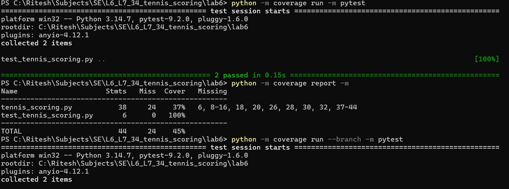
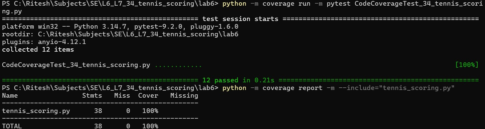
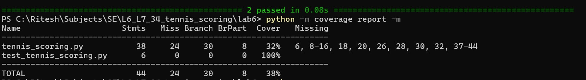
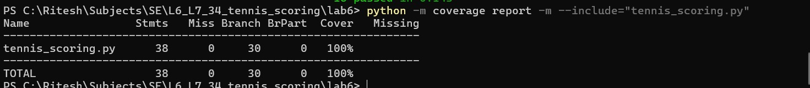

# Lab 6: Code and Branch Coverage Analysis

## Overview

This lab focuses on understanding and applying code coverage and branch coverage techniques using Python's `coverage.py` and `pytest` libraries.

The application under test is a **Tennis Scoring System** that implements game scoring, set winner determination, and match status tracking.

The objective is to design comprehensive test cases, identify untested execution paths, and achieve at least 90% code and branch coverage.

## Objectives

- Understand the difference between code coverage and branch coverage.
- Measure test coverage using Python's Coverage.py library.
- Identify untested statements and decision branches.
- Write test cases covering normal scenarios, edge cases, and conditional outcomes.
- Achieve at least 90% code coverage and branch coverage.

## Technology Stack

- **Language:** Python 3.14.7
- **Testing Framework:** pytest 9.2.0
- **Coverage Tool:** Coverage.py 7.17.0

## Test Case Design

Two separate test suites were developed.

### 1. Code Coverage Tests

**File:** `CodeCoverageTest_34_tennis_scoring.py`

Tests were written to execute all statements in the application, covering:
- Normal tennis scoring.
- Deuce and advantage situations.
- Game-winning conditions.
- Negative point validation.
- Set winner determination.
- Match status outcomes.

### 2. Branch Coverage Tests

**File:** `BranchCoverageTest_34_tennis_scoring.py`

Additional test cases were designed to exercise both True and False outcomes of conditional statements.

These include:
- Negative input validation for both players.
- Different outcomes of nested conditions.
- Advantage and game-winning branches.
- Set-winning and tiebreak conditions.
- Match winner, decider, and in-progress conditions.

## How to Run

### 1. Install Dependencies

```bash
pip install coverage pytest
```

### 2. Run Code Coverage

Clear previous coverage data:

```bash
python -m coverage erase
```

Execute the code coverage tests:

```bash
python -m coverage run -m pytest CodeCoverageTest_34_tennis_scoring.py
```

Generate the coverage report:

```bash
python -m coverage report -m --include="tennis_scoring.py"
```

### 3. Run Branch Coverage

Clear previous coverage data:

```bash
python -m coverage erase
```

Execute the branch coverage tests:

```bash
python -m coverage run --branch -m pytest BranchCoverageTest_34_tennis_scoring.py
```

Generate the branch coverage report:

```bash
python -m coverage report -m --include="tennis_scoring.py"
```

## Coverage Results

Both test suites achieved 100% coverage of the application.

| Metric | Code Coverage | Branch Coverage |
|---|---:|---:|
| Statements | 38 | 38 |
| Missed Statements | 0 | 0 |
| Branches | — | 30 |
| Partially Covered Branches | — | 0 |
| Coverage | 100% | 100% |

### Code Coveragegit status

All 38 executable statements in `tennis_scoring.py` were executed during testing.

### Branch Coverage

All 30 reported branches were covered, with zero partially covered branches.

## Screenshots

The terminal screenshots demonstrating the achieved coverage are included in this repository:

## Code Coverage:

### Before Code Coverage :


### After Code Coverage :


### Before Branch Coverage :


### After Branch Coverage :


## Conclusion

This lab demonstrates the importance of code coverage and branch coverage in software testing.

While code coverage ensures that executable statements are exercised, branch coverage verifies that different decision outcomes are tested.
